<p align="center">
  <picture>
    <source media="(prefers-color-scheme: dark)" srcset="docs/hero-dark.png">
    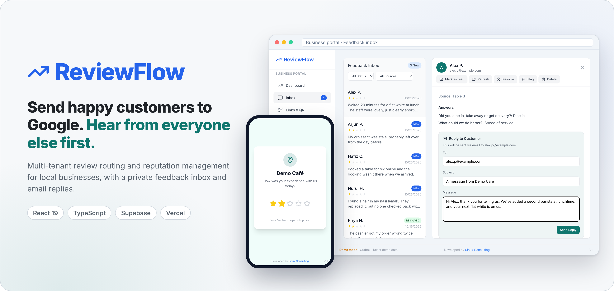
  </picture>
</p>

<p align="center">
  <a href="https://reviewflow-mrsinux.vercel.app"></a>
</p>

<p align="center">
  <a href="https://github.com/MrSinux/ReviewFlow/actions/workflows/ci.yml"></a>
  <a href="LICENSE"></a>
  
</p>

**ReviewFlow** routed customer ratings: happy customers to Google, everyone else to a private feedback inbox.\
It ran as part of [Sinux Consulting](https://sinuxconsulting.com)'s review and reputation management service for businesses in Malaysia and the US.\
Multi-tenant: a branded portal for each business, plus an agency control center with onboarding and impersonation.\
Built with React 19, TypeScript and Vite on Supabase (Postgres with row level security, Auth, Realtime, Edge Functions), hosted on Vercel.\
Now retired and kept as a reference project: it runs out of the box on built-in demo data, with no database or setup ([live demo](https://reviewflow-mrsinux.vercel.app)).

## How it works

<p align="center">
  <picture>
    <source media="(prefers-color-scheme: dark)" srcset="docs/storyboard-dark.png">
    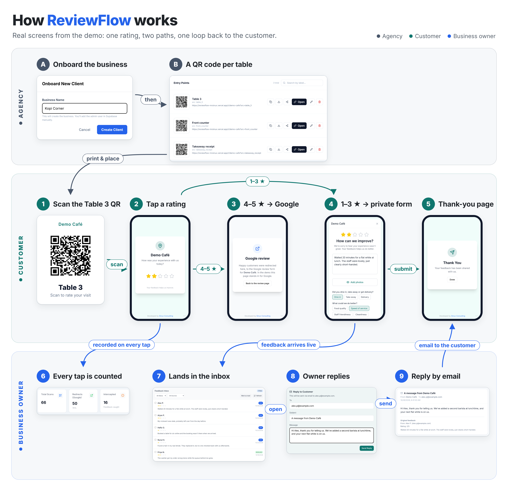
  </picture>
</p>

**Setup (the agency)**\
**A.** The agency onboards a client business from its control center.\
**B.** Each table, counter or receipt gets an entry point with its own QR code and `src` tag.

**The loop**
1. A customer at Table 3 scans the QR code, which opens `/r/demo-cafe?src=table_3` on their phone.
2. They tap a star rating. Every tap is stored as a `rating_event`, tagged with where it came from.
3. At or above the business's threshold (4 stars by default) they go straight to its Google review page.
4. Below it they get a private form instead: a comment, the business's own questions, photos, name and email.
5. A thank-you page closes the visit for the customer.
6. The business dashboard counts every scan, and whether it was redirected to Google or intercepted.
7. The feedback lands in the business's inbox as **New**, live over Supabase Realtime.
8. The owner reads it, flags or resolves it, and replies from the inbox.
9. The reply reaches the customer by email (sent by an Edge Function through Resend), quoting their original feedback.
   In the demo it is kept in an **Outbox** page instead of being sent.

## Run the demo

**Live:** <https://reviewflow-mrsinux.vercel.app> opens the login page with one-click demo logins. The customer side starts at
[`/r/demo-cafe?src=table_3`](https://reviewflow-mrsinux.vercel.app/r/demo-cafe?src=table_3), the page the Table 3 QR code opens.

**Locally:** you only need [Node.js](https://nodejs.org) 20 or newer. No accounts, keys or database.

```bash
git clone https://github.com/MrSinux/ReviewFlow.git
cd ReviewFlow
npm install
npm run dev
```

Then open <http://localhost:3000>. Either way, the login page has one-click demo logins:

| Demo login | What you can do |
| --- | --- |
| **Business admin** (owner of Demo Café) | Dashboard, feedback inbox, replies, QR codes, settings |
| **Super admin** (the agency) | Every client, onboarding, impersonating a client's portal, deleting a client |

You can also type the demo accounts in by hand: `owner@example.com` / `demo` and `super@example.com` / `demo`.

Things to try:

1. Open the [Demo Café customer page](https://reviewflow-mrsinux.vercel.app/r/demo-cafe?src=table_3) and give it **2 stars**.
   You get the private feedback form. Submit it, then [sign in](https://reviewflow-mrsinux.vercel.app/login) as the business admin and find it in the inbox.
2. Give it **5 stars** and you are redirected "to Google". In the demo a stand-in page takes Google's place.
3. As the business admin, reply to a customer, then open the **Outbox** (footer link) to see the email they would get.
4. As the super admin, onboard a new client and open any client's portal in impersonation mode.

The demo runs entirely in your browser. Its data is synthetic (fictional businesses, customers and
`example.com` addresses), lives in `localStorage`, and resets with **Reset demo data** in the footer. No email is
sent, and nothing you do is shared with other visitors. To run against a real backend instead, see
[Run it on Supabase](#optional-run-it-on-supabase).

## See it in motion

| The customer's side | The business owner's side |
| --- | --- |
| 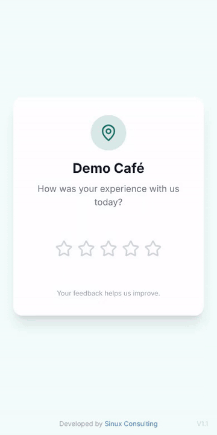 | 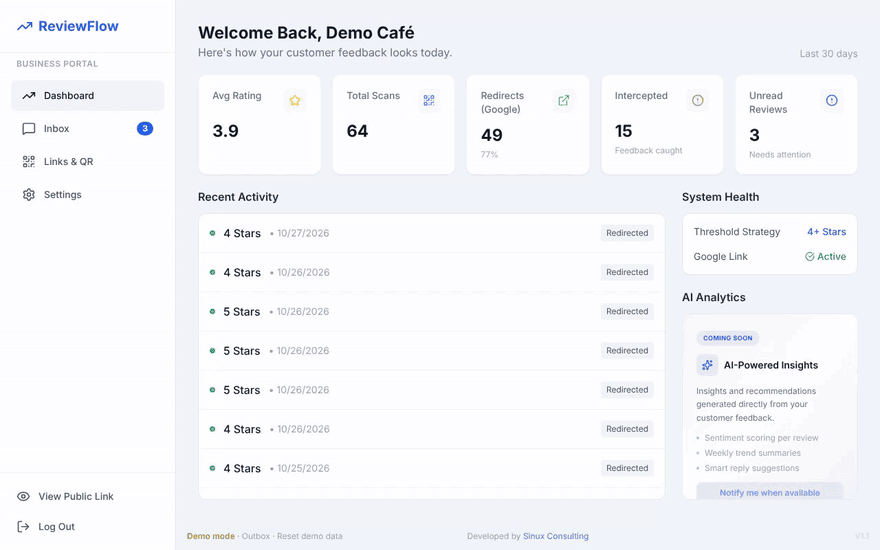 |

## Screenshots

| | |
| --- | --- |
| 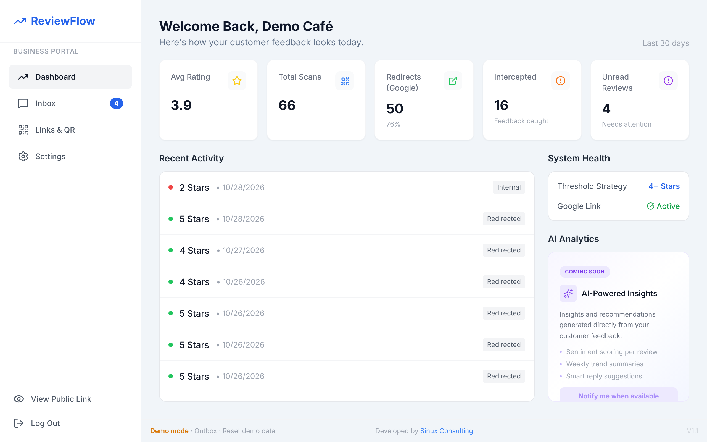 | 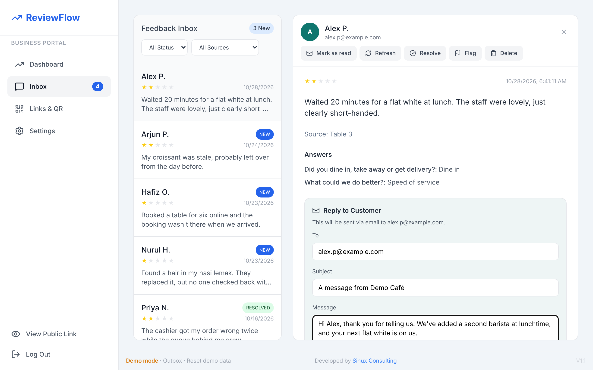 |
| **Business dashboard**: scans, Google redirects, intercepted ratings | **Feedback inbox**: statuses, answers, email replies |
| 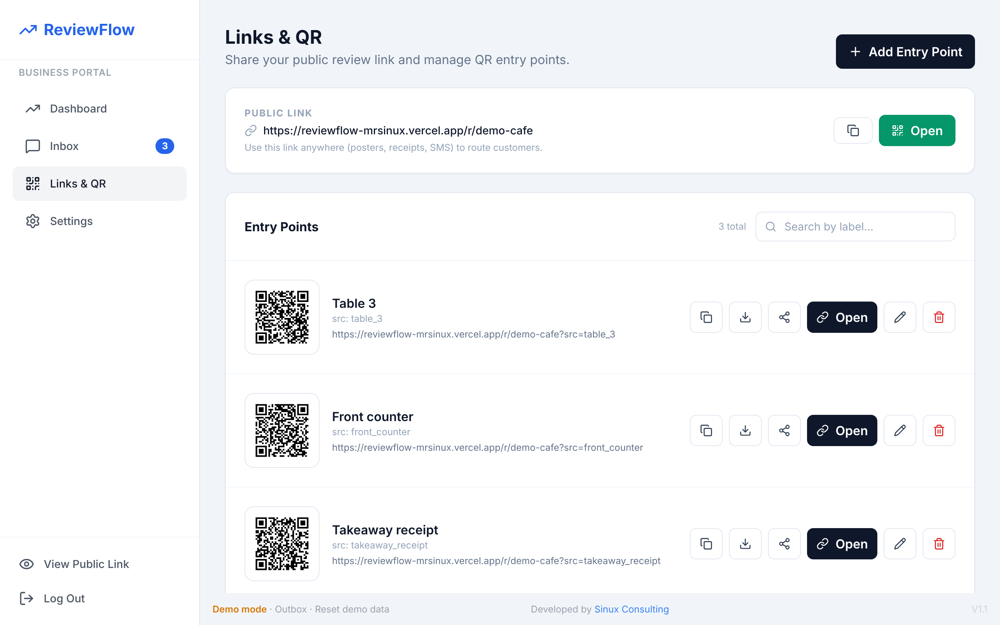 | 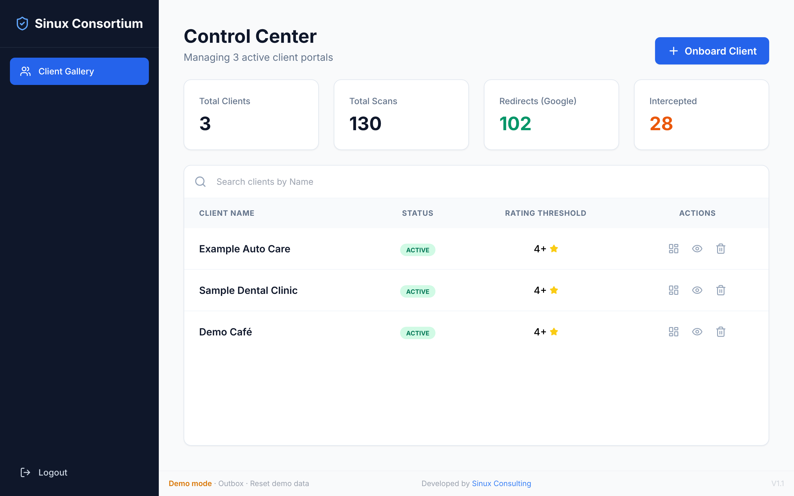 |
| **Links & QR**: an entry point and QR code per table, counter or receipt | **Super admin**: every client, onboarding, impersonation |
| 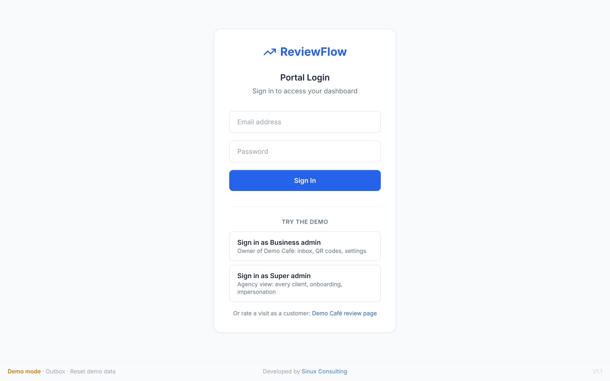 | 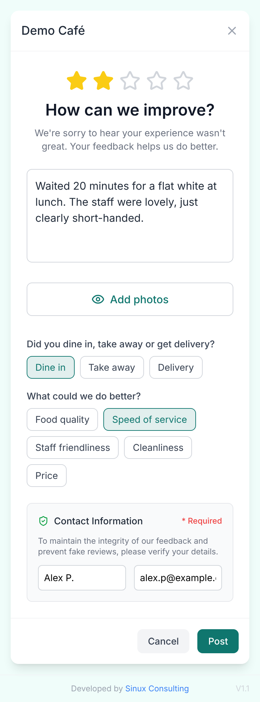 |
| **Login** with one-click demo accounts | **Private feedback form** shown below the threshold |

## Features

**Public review flow**
- Branded per business: accent colour, page and card backgrounds.
- Configurable rating threshold that decides between a Google redirect and the private form.
- Private feedback form with a free-text comment, custom questions (single choice, multiple choice or free text),
  up to 3 photos with in-page preview, and required name and email.
- Optional "exit" redirect URL for the cancel and done buttons.

**Business portal**
- Dashboard: average rating, total scans, Google redirects with percentage, intercepted (private) ratings,
  unread feedback, and a recent-activity feed.
- Feedback inbox: filter by status (new / flagged / resolved) and by entry point, auto-mark as read on open,
  mark all read, flag, resolve, delete, photo lightbox, and **email replies** sent through an Edge Function
  and logged per feedback item.
- **Live updates** through Supabase Realtime: new feedback appears in the inbox and the unread badge without a reload.
- Links & QR: the public link plus named entry points, each with its own QR code to download (PNG),
  share (Web Share API, including the image where supported) or copy.
- Settings: rating threshold, exit redirect URL and the custom question builder. Business name, Google review
  URL and theme are editable by the super admin only.

**Super admin control center**
- Client list with search, totals across all clients (scans, redirects, intercepted), and one-click onboarding.
- Impersonation: open any client's portal with a visible "Impersonation mode" banner.
- Delete a business together with its feedback, rating events, replies and user profiles.

**Auth and access**
- One login page for every role (Supabase email and password auth).
- Role-based routing (`super`, `admin`, `user`) from `public.user_profiles`, backed by row level security in the database.
  Admins are locked to their own business.

## Tech stack

Versions are the ones resolved in `package-lock.json`.

| Layer | Technology | Version |
| --- | --- | --- |
| UI framework | [React](https://react.dev) + React DOM | 19.2.4 |
| Routing | [React Router](https://reactrouter.com) (`react-router-dom`) | 7.18.5 |
| Language | [TypeScript](https://www.typescriptlang.org) | 5.8.3 |
| Build tool / dev server | [Vite](https://vite.dev) with `@vitejs/plugin-react` | 6.4.5 / 5.1.4 |
| Styling | [Tailwind CSS](https://tailwindcss.com) via the Play CDN (`cdn.tailwindcss.com`, v3) and the Inter font from Google Fonts | – |
| Icons | [lucide-react](https://lucide.dev) | 0.562.0 |
| QR codes | [qrcode.react](https://github.com/zpao/qrcode.react) | 4.2.0 |
| Backend client | [@supabase/supabase-js](https://github.com/supabase/supabase-js) | 2.95.3 (browser), 2.49.1 (Edge Function, via esm.sh) |
| Database | [Supabase](https://supabase.com) Postgres with row level security and `pgcrypto` | Supabase-managed |
| Auth | Supabase Auth (email and password) | – |
| Realtime | Supabase Realtime (`postgres_changes` on `feedback`) | – |
| Serverless | Supabase Edge Functions (Deno) | Supabase CLI 2.75 in development |
| Transactional email | [Resend](https://resend.com) REST API | – |
| Review destination | Google Business Profile "write a review" links | – |
| Hosting | [Vercel](https://vercel.com) as a static SPA (`vercel.json` rewrites every path to `index.html`) | – |
| CI | GitHub Actions: type-check and production build on Node 22 | – |

## Architecture

ReviewFlow is a single-page React app with no server of its own. In production the browser talks to Supabase
directly with the public anon key, and row level security decides what each visitor may read or write. The one
privileged operation, sending email, runs in a Supabase Edge Function that holds the service-role and Resend keys.

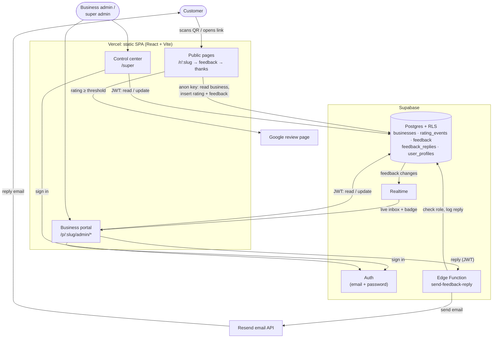

The routing decision for one customer:

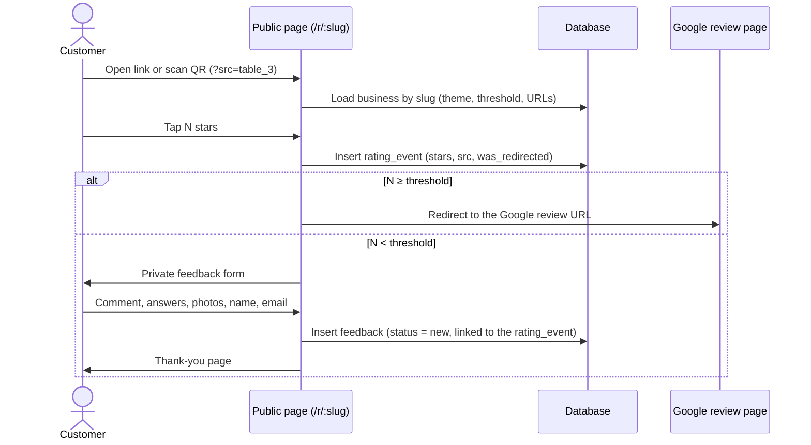

The life of a piece of feedback in the inbox:

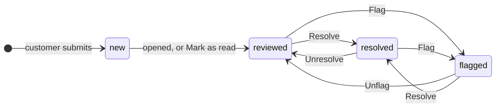

Delete removes feedback in any state. The database also allows a `spam` status, which the UI never sets.

**Demo mode.** Every page talks to two small interfaces, `dataService` and `authService`
([`services/serviceTypes.ts`](services/serviceTypes.ts)). When `VITE_SUPABASE_URL` and the anon key are set they
point at Supabase ([`services/supabase/`](services/supabase)). When either is missing they point at an in-browser
implementation ([`services/demo/`](services/demo)) seeded with synthetic data, the Supabase client is never
created, and the realtime subscriptions are skipped. The UI code is the same in both modes.

## Data model

| Table | Purpose |
| --- | --- |
| `businesses` | One row per client: `slug`, `threshold_rating`, `google_review_url`, `redirect_url`, and JSON columns for `entry_points`, `feedback_questions`, `theme` and `contact_settings`. |
| `rating_events` | Every star tap: `stars`, `src`, `was_redirected`. Drives the dashboards. |
| `feedback` | Private feedback below the threshold: comment, `answers` (JSON), name, email, `photos` (data URLs), `src`, `rating_event_id`, `status` (`new`, `reviewed`, `resolved`, `flagged`, `spam`) and last-reply fields. |
| `feedback_replies` | Audit log of every email reply: recipient, subject, body, provider message id, sender. |
| `user_profiles` | Links a Supabase Auth user to a role (`super`, `admin`, `user`) and, for admins, a business. |

**Access rules** (row level security, [`supabase/migrations/20261028_rls_policies.sql`](supabase/migrations/20261028_rls_policies.sql)):

| Table | Anonymous (public pages) | Business admin | Super admin |
| --- | --- | --- | --- |
| `businesses` | read | read; update own business, except name, slug, status, Google URL and theme (enforced by a trigger) | all |
| `rating_events` | insert | read own business | read, delete |
| `feedback` | insert (status must be `new`) | read, update, delete own business | all |
| `feedback_replies` | none | read own business | read, delete (rows are written by the Edge Function's service role) |
| `user_profiles` | none | read own row | read all, delete |

## Optional: run it on Supabase

1. Create a Supabase project (the free tier works). In the SQL Editor, run these files in order:
   1. `supabase/schema.sql`
   2. `supabase/rbac.sql`
   3. `supabase/migrations/20260429_feedback_replies.sql`
   4. `supabase/migrations/20261028_rls_policies.sql`

   (`supabase/migrations/20260208_rbac_update.sql` only upgrades databases that predate the current role
   names. It is harmless on a fresh project.)

2. Point the app at it:

   ```bash
   cp .env.example .env.local   # then set VITE_SUPABASE_URL and VITE_SUPABASE_ANON_KEY
   npm run dev
   ```

   With both variables set, the demo logins disappear and the app uses Supabase.

3. Create a super admin. In Authentication → Users → *Add user*, create a user with a strong password, then run:

   ```sql
   insert into public.user_profiles (id, role)
   values ('<AUTH_USER_UUID>', 'super')
   on conflict (id) do update set role = excluded.role;
   ```

   Sign in at <http://localhost:3000/login> and use **Onboard Client** to create a business.

4. Optionally add a business admin. Create another Auth user and link it:

   ```sql
   insert into public.user_profiles (id, role, business_id, business_slug)
   select '<AUTH_USER_UUID>', 'admin', id, slug
   from public.businesses where slug = '<business-slug>';
   ```

5. Optionally enable email replies by deploying the Edge Function with your Resend credentials.
   See [`supabase/functions/README.md`](supabase/functions/README.md).

Scripts: `npm run dev`, `npm run build` (to `dist/`), `npm run preview`, `npm run typecheck`.

## Environment variables

All variables are optional. With none set, the app runs in demo mode.

| Variable | Description |
| --- | --- |
| `VITE_SUPABASE_URL` | Supabase project URL, e.g. `https://your-project-ref.supabase.co`. |
| `VITE_SUPABASE_ANON_KEY` | Supabase anon (publishable) key. `VITE_SUPABASE_PUBLISHABLE_DEFAULT_KEY` is accepted as a fallback name. |
| `VITE_PUBLIC_APP_URL` | Base URL for public review links, QR codes and Open Graph tags. Defaults to the current browser origin. |

Everything prefixed `VITE_` is compiled into the public bundle, so only public values belong in
[`.env.example`](.env.example). The Edge Function's own secrets (`RESEND_API_KEY`, `RESEND_FROM_EMAIL`) are listed in
[`supabase/functions/.env.example`](supabase/functions/.env.example); Supabase injects `SUPABASE_URL` and
`SUPABASE_SERVICE_ROLE_KEY` itself.

## Project structure

```text
.
├── index.html                 # SPA shell: Tailwind Play CDN, Inter font, meta and OG tags
├── App.tsx                    # Route table (public, login, super, business portal, demo pages)
├── types.ts                   # Domain types (Business, Feedback, RatingEvent, UserProfile…)
├── components/
│   ├── auth/ProtectedRoute.tsx    # Session + role guard; locks admins to their own slug
│   ├── layouts/AdminLayout.tsx    # Business portal shell, sidebar, realtime unread badge
│   ├── StarRating.tsx
│   └── DevelopedByFooter.tsx      # Footer, plus the demo-mode links (Outbox, Reset demo data)
├── pages/
│   ├── LoginPage.tsx              # Unified login, with one-click demo logins in demo mode
│   ├── public/                    # Review page → feedback form → thank-you; demo Google stand-in and Outbox
│   ├── admin/                     # Dashboard, feedback inbox, Links & QR, settings
│   └── super/SuperDashboard.tsx   # Control center
├── services/
│   ├── serviceTypes.ts            # DataService / AuthService contracts
│   ├── dataService.ts             # Picks the Supabase or demo implementation
│   ├── authService.ts             # Same, for auth
│   ├── supabaseClient.ts          # Supabase client, or null in demo mode
│   ├── supabase/                  # Supabase implementations
│   ├── demo/                      # In-browser implementations, synthetic seed data, demo accounts
│   ├── publicUrl.ts               # Public base URL (VITE_PUBLIC_APP_URL or window origin)
│   └── ids.ts
├── supabase/
│   ├── schema.sql, rbac.sql       # Core tables, roles
│   ├── migrations/                # Reply log, RLS policies
│   └── functions/send-feedback-reply/   # Deno Edge Function (Resend)
├── docs/                      # Hero, storyboard, GIFs, screenshots, social preview
├── .github/workflows/ci.yml   # Type-check and build
├── DECISIONS.md               # Why it is built the way it is
└── vercel.json
```

## Limitations

ReviewFlow is published as it was retired, plus the demo mode and the access rules above.

- **Access rules are reconstructed.** The production RLS policies lived in the Supabase dashboard and were never
  committed. The policies here were written from how the app uses each table and tested against Postgres 16,
  but they are not the exact rules that ran in production.
- **Photos** are stored as base64 data URLs in a `text[]` column instead of Supabase Storage.
- **Deleting a business** is a sequence of client-side deletes, not a transaction.
- **Tailwind** loads from the Play CDN at runtime, which Tailwind does not recommend for production.
- **"AI Analytics"** on the dashboard is a "coming soon" placeholder and was never built.
- **Demo mode** keeps its data in one browser's `localStorage`, sends no email, and has no realtime updates
  (use the inbox's Refresh button).

## Decisions

The main design choices and their trade-offs are written up in [DECISIONS.md](DECISIONS.md).

## Credits

Designed and built by **[Lohan Ramachandran](https://lohansinux.com)** at **[Sinux Consulting](https://sinuxconsulting.com)**.

## License

[MIT](LICENSE) © 2026 Lohan Ramachandran
